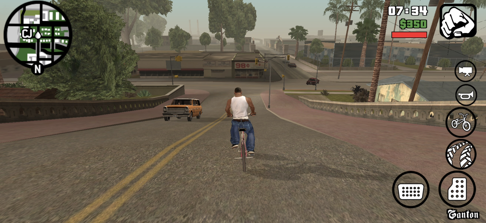
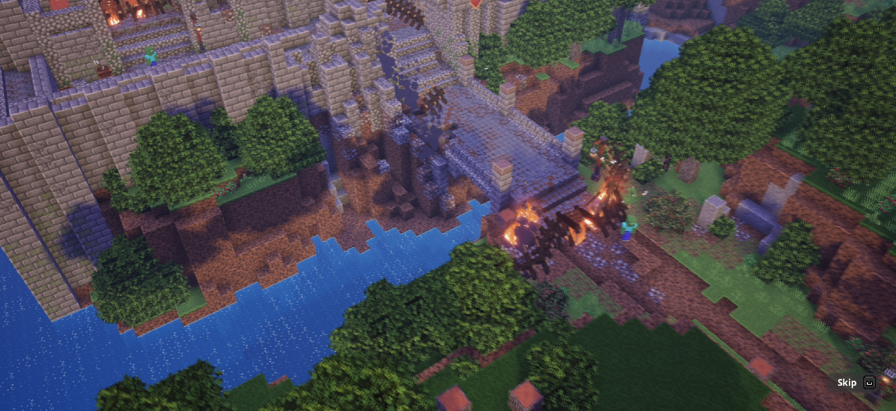
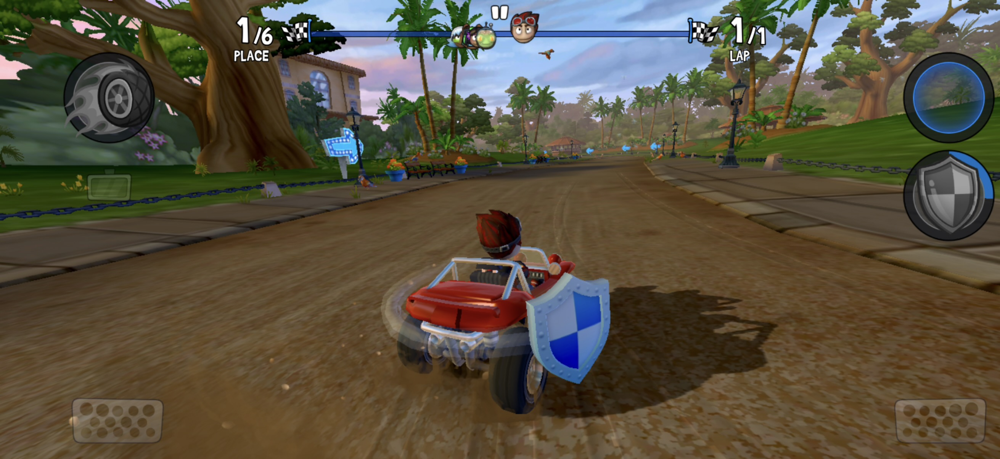
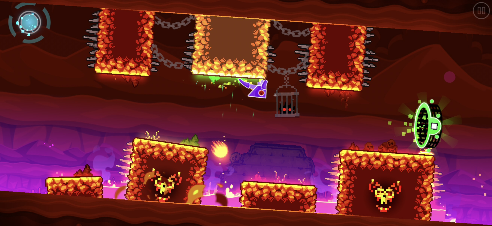
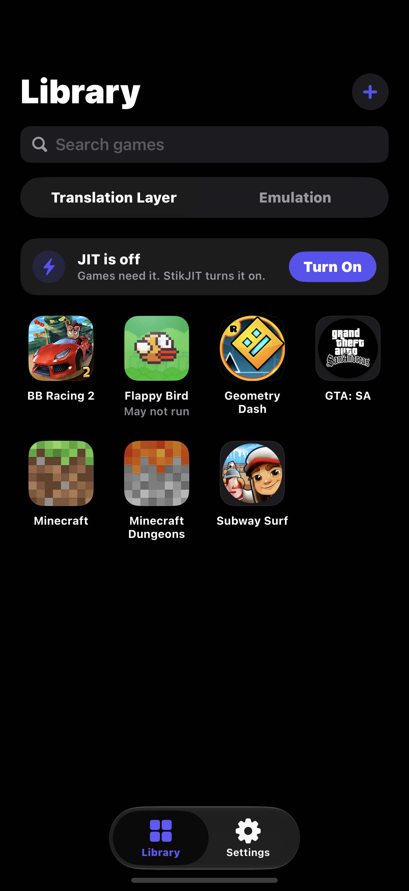
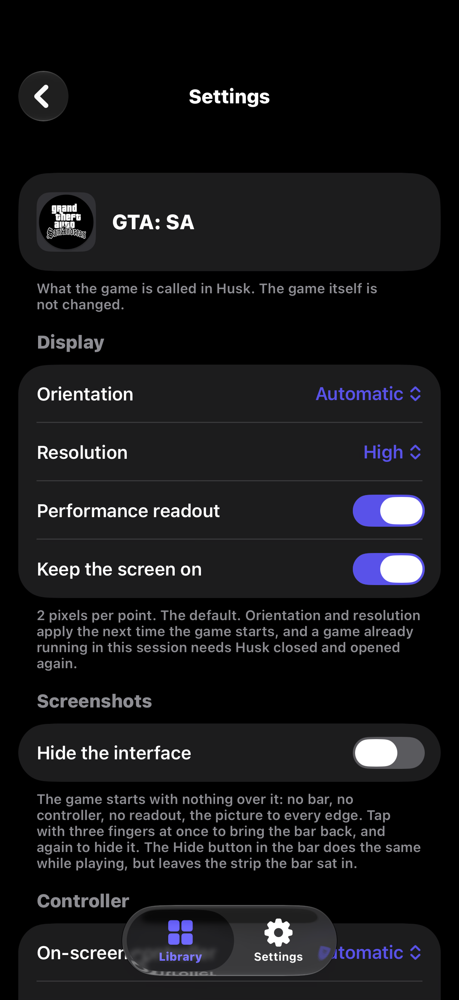
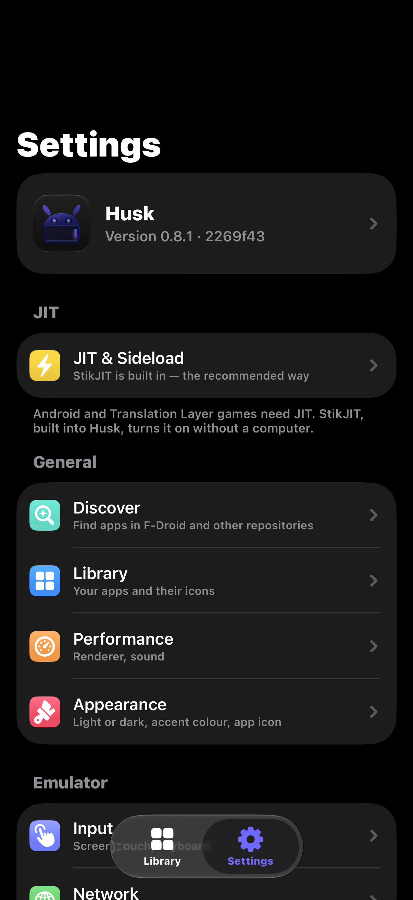

# Husk 中文汉化版

> 本项目为 [Leviidev/Husk](https://github.com/Leviidev/Husk) 的中文汉化分支，基于原项目完整汉化，保留原有 GPL-2.0-or-later 开源协议。
> 原作者：Leviidev。中文汉化由 wusignal 完成。

在你的 iPhone 上运行 Android 应用和游戏。

添加一个 APK，点一下，它就会全屏打开。Husk 通过两种方式运行它，分别对应资源库的两个分区：

- **翻译层（Translation Layer）**。游戏自带的 64 位 Android 代码直接在 iPhone 处理器上运行，Husk 在周围充当 Android：C 库、游戏发起的 Java 调用、OpenGL ES（通过 ANGLE）、Vulkan（通过 MoltenVK）、声音、触摸和手柄。不需要启动 Android，因此游戏几秒钟就能启动，其代码从不被模拟。
  详见 [docs/04-translation-layer.md](docs/04-translation-layer.md)。
- **模拟运行（Emulation）**。一个完整的 Android 系统（LineageOS）在 Husk 内部通过 QEMU 启动，用于翻译层暂时跑不了的应用，以及使用 Android 本身。iOS 不给 App 虚拟化权限，因此处理器是模拟的，比翻译层慢得多。
  详见 [docs/00-architecture.md](docs/00-architecture.md)。

## 截图

### 翻译层游戏

<table>
  <tr>
    <td align="center"><br><sub><b>GTA: San Andreas</b></sub></td>
    <td align="center"><br><sub><b>Minecraft Dungeons</b></sub></td>
  </tr>
  <tr>
    <td align="center"><br><sub><b>Beach Buggy Racing 2</b></sub></td>
    <td align="center"><br><sub><b>Geometry Dash</b></sub></td>
  </tr>
</table>

### App 界面

<table>
  <tr>
    <td align="center" width="33%"><br><sub><b>资源库</b></sub></td>
    <td align="center" width="33%"><br><sub><b>游戏设置</b></sub></td>
    <td align="center" width="33%"><br><sub><b>设置</b></sub></td>
  </tr>
</table>

## 翻译层能运行什么

使用 Husk 已有驱动的引擎制作的游戏：

- Unity
- Unreal Engine 4（通过 Vulkan）
- cocos2d-x
- Godot 3 和 4（GLES2、GLES3 及 Compatibility 渲染器）
- SDL2 和 SDL3，包括 LÖVE 游戏
- GameActivity（Minecraft）和 NativeActivity
- Rockstar 自研引擎（GTA: San Andreas）

游戏看到的 Google Play 服务是"已安装但未登录"状态，因此检查它的游戏能正常启动；Play Games 登录、云存档和内购不可用。Geometry Dash 可以加载 [Geode](https://geode-sdk.org) Mod。

APK 需要 64 位（`arm64-v8a`）原生代码。iPhone 不能运行 32 位 ARM 代码，因此只有 32 位库的 APK 无法在此运行。APK 和拆分整包（`.xapk`、`.apkm`、`.apks`，或 Play 下载的独立拆分 APK 和资源包）都可以添加。仅用 Java 编写、没有原生引擎的应用不支持翻译层；请用模拟运行来跑它们。

每次启动 Husk 只能运行一个游戏。要切换，在另一个游戏的页面按"关闭 Husk 以开始游玩"；再次打开 Husk 时，那个游戏会自行启动。

游戏存档可以从其页面备份为 `.zip`，之后在同一台 iPhone 或其他设备上恢复。如果某个游戏导致 Husk 崩溃，下次启动会显示发生了什么，并提供可分享的报告。

## 安装

**SideStore、AltStore 及其他侧载工具：** 添加 Husk 的源，侧载工具会安装 Husk 并在每次更新时推送。

```
https://raw.githubusercontent.com/wusignal/Husk_CN/main/altsource.json
```

在 SideStore 或 AltStore 中：源 › + › 粘贴上面的地址。

**或手动安装：** 从 [Releases](https://github.com/wusignal/Husk_CN/releases) 下载 `Husk.ipa`，用 SideStore、AltStore 或 TrollStore 安装。同一个 IPA 通吃三者：它带有 Husk 的 entitlements，TrollStore 直接保留，侧载工具会用你自己的证书重签。

Husk 需要 iOS 16.0 或更高版本。

## JIT

翻译层和模拟运行都需要 JIT，在 iOS 上这来自调试器。Husk 支持多种方式获取 JIT，并引导你完成每一步（设置 › JIT 与侧载）：

- **内置 StikJIT**（iOS 26 及以上）：Husk 自行开启 JIT，无需第二个 App。在 iOS 27 上它从设置与你的 iPhone 配对，无需电脑。详见 [docs/06-built-in-jit.md](docs/06-built-in-jit.md)。
- **StikDebug**，与 Husk 并排安装。
- **TrollStore 或 Dopamine 越狱**（"允许 App 使用 JIT"），仅 iOS 26 之前版本可用。从 iOS 26 起只有调试器能授予 JIT。

## 从源码构建

Husk 在带 Xcode 的 Mac 上构建。构建脚本还会调用 `meson`、`ninja`、`pkg-config`、`python3`、`xcodegen`、`qemu-img` 和带 `aarch64-apple-ios` 目标的 Rust 工具链。

```sh
./scripts/ci_build.sh
```

从干净的检出开始，它会拉取并交叉编译 Husk 链接的所有内容：

- QEMU 及其依赖
- ANGLE 和 virglrenderer
- MoltenVK
- 设备端配对库

然后构建 App 并将 IPA 写到 `build/Husk.ipa`。首次运行需要几个小时，之后的运行会复用已构建的内容。之后运行 `./scripts/package_ipa.sh` 仅重建 App 并将 IPA 写到 `~/Desktop/Husk.ipa`。

`tools/regress/run.sh` 在 Mac 上通过翻译层运行一组游戏，并与参考截图比对（所需内容见 `tools/regress/cases.txt` 顶部）。

## 许可证

GPL-2.0-or-later。Husk 链接了 QEMU（GPLv2），因此发布的二进制是 GPLv2 组合作品，完整源码公开。翻译层是 Husk 自有代码，采用同一许可证。Husk 无法上架 App Store，既是因为许可证，也因为它需要 `get-task-allow` 以及运行时附着的调试器。详见 [docs/01-licensing.md](docs/01-licensing.md)。

---

**中文汉化版说明**：本分支在原项目基础上将 App 界面、文档和注释翻译为简体中文，未修改任何运行逻辑。原项目地址：<https://github.com/Leviidev/Husk>。
